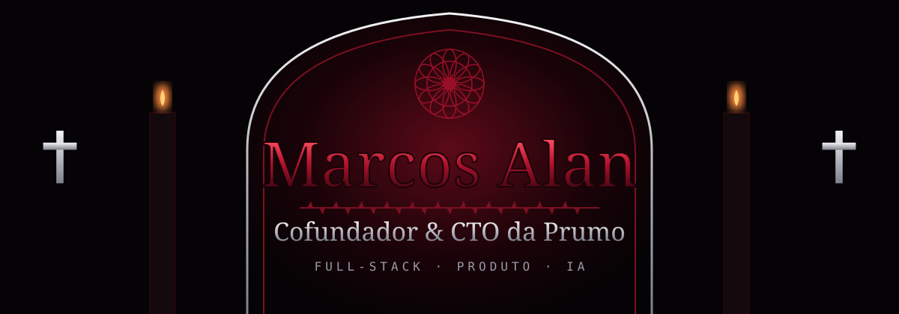

&nbsp;&nbsp;

<i>“No matter where you are, everyone is always connected.”</i> · Lain&nbsp;&nbsp;✝&nbsp;&nbsp;<i>射殺せ、神鎗</i> · Gin

**Cofundador e CTO da [Prumo](https://estudeprumo.com)**, plataforma de estudos com IA para ENEM e concursos. 
Full-stack · produto · IA aplicada · Hortolândia, SP · Rumo à Engenharia de Software

<h2></h2>

| | |
|---|---|
| Produto | SaaS de estudos com IA · em produção · usuários pagantes |
| Plataformas | Web · iOS · Android |
| Papel | Full-stack na web: front-end, APIs, banco e integrações · UI dos apps |
| Time | 2 fundadores · segurança e apps nativos com [Victor Candido](https://github.com/burnoutscript) |

<table>
  <tr>
    <td></td>
    <td></td>
  </tr>
</table>

### Funcionalidades

| Área | |
|---|---|
| Estudo | Simulados · flashcards · caderno de erros · objetivos · Modo Foco |
| Redação | Correção por IA · OCR de redação manuscrita |
| Gamificação | XP e níveis · streak · conquistas · missões · prova chefe · avatar · mascote |
| Social | Duelo · ranking · ligas · torneios · times · convites · perfil público · Discord |
| Negócio | Planos e Pix · push notifications · resumo semanal |

Estudos de caso: [prumo](https://github.com/nullfeel/prumo) (web) · [prumo-apps](https://github.com/nullfeel/prumo-apps) (UI mobile)

<h2></h2>

| | |
|---|---|
| Produto | Player de música para Windows · gratuito · [download](https://prumo-player.vercel.app) · [estudo de caso](https://github.com/nullfeel/prumo-player) |
| Stack | Tauri 2 · Rust · Svelte · TypeScript |
| Recursos | FLAC, MP3, Opus · gapless · equalizador · ReplayGain · letra sincronizada · biografia · Last.fm · Discord Rich Presence |
| Distribuição | Instalador assinado · atualização automática · site próprio |

<h2></h2>

| | |
|---|---|
| Front-end | Next.js App Router · React 19 · design system próprio · animação (GSAP, SVG) · acessibilidade |
| Back-end | ~40 rotas de API · Supabase (Postgres, Auth, Storage) · 120+ migrations · jobs agendados |
| IA | Integração com LLMs · correção de redação · OCR · geração de questões |
| Desktop | Tauri 2 · Rust · áudio nativo · atualização automática assinada |
| Integrações | Pagamentos via Pix e webhooks · web push · Discord · Sentry |
| Produto | Gamificação · retenção · métricas de uso |
| Ferramentas | Claude Code · Cursor · OpenCode · Kimi · Vitest · Git |

<h2></h2>

   
   
  
  

<h2></h2>

| Projeto | Descrição |
|---|---|
| [mascote-vivo](https://github.com/nullfeel/mascote-vivo) | Animação de mascotes SVG: olhar, piscar, pulo e comemoração · TypeScript · GSAP · Vitest · [demo](https://nullfeel.github.io/mascote-vivo/) |

 

  

